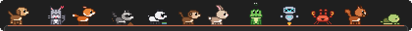

# Claude Pets

A tiny pixel pet lives on top of the **Claude Code** prompt box in VS Code. It breathes, blinks,
wags its tail and wanders around – and it reacts to what Claude is doing, to your typing and to
your mouse.

> **Free and open source – and it will stay that way.** Claude Pets is free software under the
> MIT license. There is no paid tier and nothing to unlock: every feature is always available to
> everyone. If you enjoy your pet and would like to support the project, you can do so on Ko-fi:
>
> 

Twelve pets to choose from: dog, cat, fox, raccoon, panda, monkey, rabbit, frog, robot, crab,
squirrel and turtle. All of them share the same 49 animations, each adapted to the animal – the cat
hides a fish instead of a bone, the frog snaps a fly, the robot hovers on a little jet.

## Installation

1. Install the [Claude Code](https://marketplace.visualstudio.com/items?itemName=anthropic.claude-code) extension.
2. Install Claude Pets: `code --install-extension claude-pets-0.2.0.vsix`
3. On first start Claude Pets sets everything up and shows
   *"Claude Pets is ready. Reload the window to let your pet appear."* → **Reload Window**.

Building from source: `npm install`, `npm test`, `npm run build`, `npm run package`, then
`npm run install-local`.

### How does the pet get into Claude Code?

VS Code does not let one extension draw into the user interface of another. Claude Pets therefore
appends a clearly marked block to Claude Code's webview files (`webview/index.js`,
`webview/index.css`) and allows connections to `http://127.0.0.1` in Claude Code's Content Security
Policy (`extension.js`), so that hook events can reach the pet. Before the first change, a backup
`*.claude-pets.bak` is created for each file. After an update of Claude Code, the new version is
patched automatically.

## What your pet reacts to

| What happens | Your pet … |
| --- | --- |
| you type | watches |
| you send a prompt | perks up, then thinks |
| Claude reads or searches files | sniffs around |
| Claude writes code | digs |
| web search / fetching a page | listens |
| tests are running | is eager – then happy or sad |
| `npm install` and friends | gets impatient |
| other commands | runs |
| a permission is needed | barks (or meows, croaks, beeps …) |
| Claude is done | is happy |
| something went wrong | is sad |
| you cancel with Escape | puts its ears back |
| nothing happens for a while | lies down and falls asleep |

Plus little extras: a yawn when the conversation is compacted, a bone for every returning
subagent, a nod when CLAUDE.md has been read.

## Interactions

- **Pet it:** move the mouse quickly back and forth over the pet.
- **Poke it:** click once.
- **Toolbar:** hovering over the pet shows four buttons:
  - **Bowl** – the pet walks over and eats.
  - **Treat** – tossed and caught.
  - **Toy** – grab it, drag and let go: it flies, and the pet fetches it.
  - **Rope** – hold it and pull it to the pet's mouth: tug of war for as long as you hold on.
- **Belly rub:** when the pet is lying down (context menu → *Lie down*), circle the mouse over it.
- **Call it:** double-click just above the top edge of the prompt box – the pet comes over.
- **Context menu** (right-click): *Sit*, *Lie down*, *Give paw*, *Spin*, *Sleep*, *Change pet …*,
  *Hide (until reload)*.
- If the mouse rests on the pet while you are typing, the pet becomes translucent.

The pet never gets in the way of your input: text in the prompt box is never covered, and clicks
into the input field always work. It follows the box when it grows (multi-line prompts, banners
docked on top of it) and moves onto the permission card while Claude is asking for approval.

## Settings

| Setting | Default | Meaning |
| --- | --- | --- |
| `claudePets.enabled` | `true` | Show the pet (off = remove the injection and the hooks) |
| `claudePets.species` | `dog` | The pet, or `random` for a different one on every start |
| `claudePets.scale` | `2` | Pixel size 1–4 |
| `claudePets.showButtons` | `true` | Toolbar when hovering over the pet |
| `claudePets.hooks.enabled` | `true` | Register Claude Code hooks |
| `claudePets.idle.wander` | `true` | Wander around while idle |
| `claudePets.idle.sleepAfterMinutes` | `4` | Fall asleep after this many quiet minutes |
| `claudePets.opacityOnHover` | `0.35` | Opacity while the mouse rests over the pet |
| `claudePets.reduceMotion` | `auto` | `auto` follows the system, `on`, `off` |
| `claudePets.patchCsp` | `true` | Extend Claude Code's CSP for hook events |
| `claudePets.debug` | `false` | Verbose logging |

## Commands

All under "Claude Pets: …" in the Command Palette: **Enable**, **Disable**, **Reapply**,
**Choose Pet…**, **Install Hooks**, **Remove Hooks**, **Show Diagnostics**.
The status bar shows the current pet ("🐾 Dog"); click it to choose another one.

## Privacy

- Claude Pets registers asynchronous hooks in `~/.claude/settings.json`. They run in the
  background and never slow Claude down. The hook script prints nothing and always succeeds.
- The script sends a slimmed-down event to a local server of the extension (`127.0.0.1`, ports
  47811–47830, protected by a random token). Prompts, file contents and command output never leave
  the hook process.
- The pet only receives: the event name, the tool name, a command category (test, install, commit,
  other), success or failure, the notification type and a short, non-reversible hash of the session
  id (so that every pet only reacts to its own session).
- The text in the prompt box is never read – only *that* you are typing.
- Nothing is sent to the internet. Files are only written for `claudePets.debug`
  (`~/.claude-pets/debug.log`); otherwise just the token and the window list in `~/.claude-pets/`.

## Uninstalling

- **Temporarily:** "Claude Pets: Disable" removes the blocks from Claude Code, the CSP addition and
  the hooks. Then reload the window.
- **Completely:** uninstall the extension and restart VS Code. The uninstall script then removes the
  changes from every installed Claude Code version, the hooks and `~/.claude-pets`. Only the backup
  `~/.claude/settings.json.claude-pets.bak` is kept.

## About the icon

The icon shows the upper half of the Claude logo inside the prompt box the pet sits on, to make
clear which extension the pet lives in. Claude Pets is an independent hobby project and is not
affiliated with or endorsed by Anthropic. If Anthropic would prefer that the logo not be used, I
apologise – I will remove it right away. Anthropic is welcome to get in touch with me at any time,
for example by [opening an issue](https://github.com/stefantasie-vscode-extensions/claude-pets/issues).

## More

- Design decisions: [docs/DECISIONS.md](docs/DECISIONS.md)
- Manual test plan: [docs/TEST_PLAN.md](docs/TEST_PLAN.md)
- Changes: [CHANGELOG.md](CHANGELOG.md)

## License

MIT © Stefan Kley
